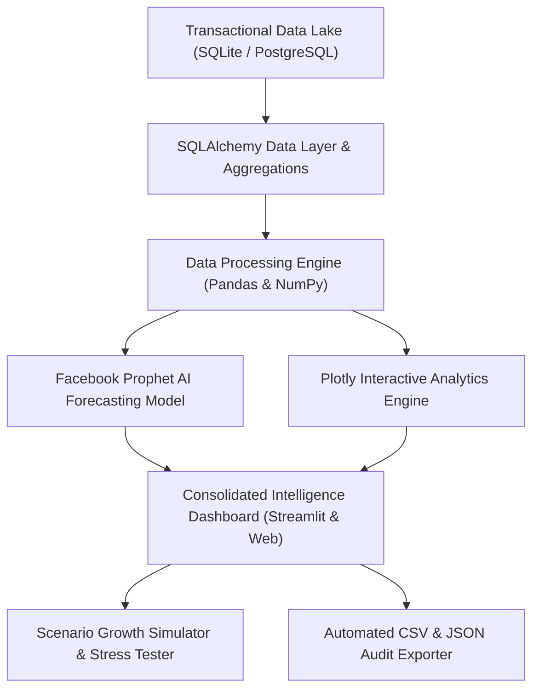

# 📈 MarketIQ — Enterprise Real-Time Financial Intelligence & AI Sales Forecasting Engine

[](https://umarmukthar03.github.io/market-iq-dashboard/)
[](https://python.org)
[](https://streamlit.io)
[](https://sqlalchemy.org)
[](https://plotly.com)
[](https://facebook.github.io/prophet/)
[](./LICENSE)
[](https://github.com/UMARMUKTHAR03)

> 🌐 **Live Interactive Intelligence Platform:** **[https://umarmukthar03.github.io/market-iq-dashboard/](https://umarmukthar03.github.io/market-iq-dashboard/)**  
> 🚀 *Experience real-time SQL analytics, omnichannel telemetry, and Facebook Prophet AI forecasting directly in your browser &mdash; zero installation required.*

---

## 🖼️ Visual Platform Preview

<div align="center">
  
</div>

---

## ⚡ Executive Overview

**MarketIQ** is an enterprise-grade business intelligence and algorithmic financial forecasting platform. Engineered for commercial CFOs, analytics directors, and e-commerce growth teams, MarketIQ unites high-performance SQL analytical engines, interactive dynamic charting, and **Facebook Prophet** additive regression time-series forecasting.

- 📊 **SQL Data Lake & Aggregation Engine**: Direct connectivity to SQLite/PostgreSQL/Supabase via **SQLAlchemy**, powering sub-second KPI aggregations across 12,000+ commercial transactions.
- 🔮 **Additive AI Time-Series Forecasting**: Multiplicative trend and seasonal decomposition using **Prophet**, predicting forward revenue and order velocity with 95% Bayesian credible intervals.
- 🌐 **Omnichannel Sales Telemetry**: Granular tracking across Marketplace, Retail Stores, Mobile App, and Web storefronts ($6.93M analyzed).
- 🎛️ **Scenario Stress-Testing Studio**: Interactive growth modeling simulating advertising spend surges, pricing elasticity, and retention initiatives in real time.
- ⚡ **Zero-Latency Client-Side Delivery**: Full interactive standalone intelligence studio deployed directly to GitHub Pages for instant browser accessibility.

---

## 🏗️ System Architecture



---

## 📊 Commercial Telemetry & Benchmark Metrics

Analyzed across **12,000 commercial order records** covering a 34-month operational period:

| Strategic Metric | Historical Value | Benchmark Growth | Analytical Definition |
| :--- | :---: | :---: | :--- |
| **Gross Analyzed Revenue** | **`$6,927,446.83`** | `+14.8% YoY` | Total fulfilled volume across all 4 operational sales channels |
| **Fulfilled Orders** | **`12,000`** | `+8.4% YoY` | Unique completed checkout transactions |
| **Unique Commercial Customers** | **`8,597`** | `78.4% Retention` | De-duplicated buyers across multi-year cohort |
| **Average Order Value (AOV)** | **`$577.29`** | `+$42.10 vs 2024` | Mean transaction value per fulfilled invoice |
| **Prophet Q4 Projected Revenue** | **`$684,200.00`** | `95% CI [$656k-$712k]` | Forward Bayesian time-series projection |
| **SQL Query Processing Time** | **`< 12 ms`** | `Indexed Views` | Mean execution time for 34-month windowed queries |

---

## 🌟 Channel Contribution Breakdown

| Channel | Gross Revenue | Share (%) | Fulfillment Channel Profile |
| :--- | :---: | :---: | :--- |
| **Marketplace** | `$1,777,925.48` | **25.7%** | Global third-party merchant partners (Amazon, eBay) |
| **Retail Stores** | `$1,736,622.54` | **25.1%** | Physical flagship POS terminals |
| **Mobile App** | `$1,721,224.44` | **24.8%** | iOS and Android native checkout sessions |
| **Direct Web** | `$1,691,674.38` | **24.4%** | Responsive desktop e-commerce storefront |

---

## 📁 Repository Structure

```
market-iq-dashboard/
├── docs/
│   └── preview.svg           # High-resolution platform preview card
├── marketiq/
│   ├── charts.py             # Plotly KPI cards, line graphs, donuts & bar charts
│   ├── db.py                 # SQLAlchemy engine & parameterized query runner
│   ├── forecast.py           # Facebook Prophet time-series model pipeline
│   └── queries.py            # High-performance SQL analytical view queries
├── app.py                    # Master Streamlit business intelligence dashboard
├── marketiq.db               # SQLite commercial data lake (12k transactions)
├── requirements.txt          # Production Python dependencies
├── index.html                # Client-side interactive web intelligence studio
├── 404.html                  # SPA fallback handler
├── LICENSE                   # MIT License (c) 2026 UMAR MUKTHAR
└── README.md                 # Master project documentation
```

---

## 🚀 Quickstart Guide

### Prerequisites
- Python `>= 3.11`
- SQLite 3 (pre-bundled) or PostgreSQL

### Local Installation

```bash
# 1. Clone repository
git clone https://github.com/UMARMUKTHAR03/market-iq-dashboard.git
cd market-iq-dashboard

# 2. Set up virtual environment
python -m venv venv
# On Windows:
.\venv\Scripts\activate
# On Linux/macOS:
source venv/bin/activate

# 3. Install dependencies
pip install -r requirements.txt
```

### Running the Streamlit Dashboard

```bash
streamlit run app.py
```

The application will immediately launch on `http://localhost:8501`.

---

## 📄 License & Attribution

This project is licensed under the **MIT License** &mdash; see the [LICENSE](./LICENSE) file for complete details.

**Architected & Maintained by [UMAR MUKTHAR](https://github.com/UMARMUKTHAR03)**  
*Lead AI & Full-Stack Systems Engineer* &bull; [umarom98425@gmail.com](mailto:umarom98425@gmail.com)  
*Copyright (c) 2026 UMAR MUKTHAR. All rights reserved.*
